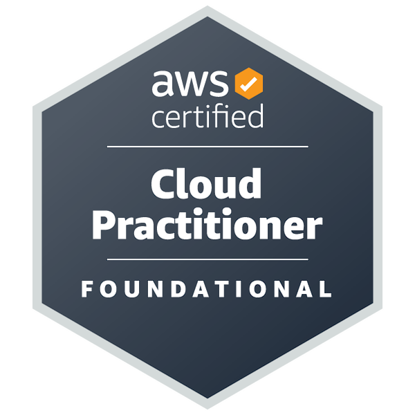

<h1 align="center">Hi, I'm Devarshi Nichite 👋</h1>

  <b align="center">AWS Certified Cloud Practitioner | Cloud & DevOps</b>

  <a href="mailto:devarshinichite@yahoo.com">📧 Email</a>

### 👨‍💻 About Me

I'm currently focused on learning and building pipelines; practical cloud infrastructure skills through **AWS projects, homelabs, and hands-on labs** - with an emphasis on understanding how systems are designed, deployed, secured, and connected.

### 🛠️ Technologies & Tools

  
  
  
  
  
  
  
  

### ☁️ AWS Certification - AWS Certified Cloud Practitioner - CLF-C02

  
  

### 🚀 Featured Projects

**☁️ [AWS Cloud Journey](https://github.com/devarshinichite/aws-cloud-journey)**

**🔐 [Homelab VPN](https://github.com/devarshinichite/aws-cloud-journey/tree/main/Homelab%20VPN)**  

**☁️ [Cloud Asset Manager](https://github.com/devarshinichite/cloud-asset-manager)**

**🌐 Reverse Proxy / Application Deployment**   

👉 **[View all projects & technical documentation →](https://devarshinichite.github.io/#projects)**

### 💼 Experience

**IT Support Engineer/IT Supervisor - NCC Directorate, Maharashtra**  
6-month contractual role, Systems Administration, Networking, Troubleshooting, Infrastructure Support

Worked with **40+ systems, 50+ IT assets, Windows Server, Active Directory, Group Policy, firewalls, LAN infrastructure, backups, system deployment, and technical troubleshooting.**

---

---
